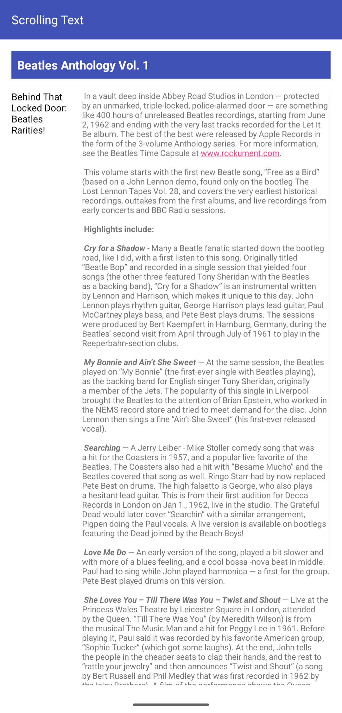

# ScrollingText

Preprosta Android aplikacija za prikaz daljšega besedila z možnostjo pomikanja po zaslonu, izdelana v programskem jeziku **Java** z uporabo **XML**.

Projekt je bil razvit v okolju Android Studio kot del šolske naloge pri predmetu Razvoj mobilnih aplikacij.

## Funkcionalnosti

- Prikaz daljšega članka o glasbeni skupini The Beatles.
- Navpično pomikanje po besedilu z uporabo `ScrollView`.
- Razporeditev besedila v dva stolpca z uporabo `LinearLayout`.
- Prikaz naslovov in besedila z uporabo `TextView`.
- Uporaba datoteke `strings.xml` za shranjevanje besedila.
- Prikaz kratkega obvestila ob oddaji komentarja z uporabo `Toast`.

## Posnetki zaslona

### Prikaz članka

## Uporabljene tehnologije

| Tehnologija | Namen |
|---|---|
| Java | Programska logika aplikacije |
| XML | Oblikovanje uporabniškega vmesnika |
| ScrollView | Pomikanje po besedilu |
| LinearLayout | Razporeditev vsebine |
| TextView | Prikaz besedila |
| Android Studio | Razvojno okolje |
| Gradle | Gradnja projekta |

## Delovanje aplikacije

Aplikacija prikazuje članek o glasbeni skupini The Beatles in zbirki posnetkov **Anthology**.

Besedilo je razdeljeno na dva stolpca. Levi stolpec prikazuje podnaslov, desni pa glavno besedilo članka.

Uporabnik lahko z drsenjem pregleduje celotno vsebino. Aplikacija omogoča tudi prikaz kratkega obvestila ob pritisku na gumb za oddajo komentarja.

## Zagon projekta

1. Prenesite ali klonirajte repozitorij.
2. Odprite projekt v Android Studiu.
3. Počakajte na sinhronizacijo Gradle.
4. Izberite emulator ali Android napravo.
5. Zaženite aplikacijo z gumbom **Run**.

## Namen projekta

Cilj projekta je spoznati prikaz daljših besedil, uporabo drsnega pogleda in razporeditev vsebine v več stolpcev.

Projekt je namenjen izobraževalnim namenom.
